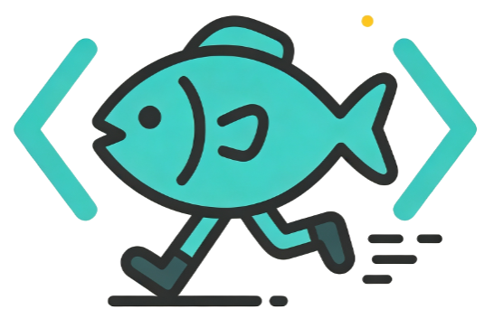

<p align="center">
  
</p>

<h1 align="center">SAG</h1>

<p align="center"><strong>SQL-Retrieval Augmented Generation with Query-Time Dynamic Hyperedges</strong><br/>事件-实体索引 · 查询时动态超边 · 写给 Agent 开发工程师的进阶手册</p>

<p align="center">鱼心快跑，Bug 追不上 · <strong>非官方教程</strong> · 事实以 <a href="https://sag.wiki/">官方文档</a>与 <a href="https://arxiv.org/abs/2606.15971">arXiv:2606.15971</a> 为准</p>

---

## 这个仓库有什么

| 内容 | 说明 |
| --- | --- |
| 主页 | 面向已掌握 RAG 的进阶读者：宣言 → 立即动手 → 全景地图 → 基准 → 落位 → 观点 → 风险 → 官方与姊妹站 |
| 19 篇教程 × 2 语言 | 基础 3 / 架构 4 / 论文与基准 2 / 工程 4 / 集成 2 / 争议边界 1 / 排坑 1 / 资料与关于 2，中英镜像 |
| 6 个可视化组件 | Hero 信息图、事件-实体数据模型、离线/在线管线、可交互超边组装、真实基准条、可回放 trace |
| 1 个可运行示例 | `examples/python/sag_minimal.py`：零依赖演示 event-entity 索引与 SQL JOIN 动态超边 |
| 资料与出处 | 官方一手资料、国内外社区解读、数字口径与时效声明集中在一页 |

内容基于三个指定网页（[官方仓库](https://github.com/Zleap-AI/SAG)、[官方论文与基准页](https://www.sag.wiki/en/project/paper)、[官方介绍](https://sag.wiki/guide/introduction)）以及 arXiv 原文、官方 wiki 全站与国内外社区解读。所有基准数字标注来源，不跨来源拼接。

## 本地运行

需要 Node.js >= 20。

```bash
npm install
npm run dev       # http://localhost:5173
npm run build
npm run preview
```

特性：简体中文 / English 双语、浅色 / 深色主题、本地搜索、响应式（窄屏结构变形）、`prefers-reduced-motion`、代码块恒深色。

## 跑通最小内核

```bash
cd examples/python
python sag_minimal.py
# Windows 编码问题： python -X utf8 sag_minimal.py
```

零依赖、Python 3.10+。脚本依次打印 `OFFLINE INDEX → QUERY-TIME SQL EXPANSION → CONTEXT PACK → VERIFY`，末尾自带断言，验证「JOIN 会带出噪声、重排会剔除噪声」。这是**教学近似**（手工标注 event/entities + `LIKE` 代替 LLM 抽取与 embedding），官方实现请用 `pip install zleap-sag`。四个建议实验见 [examples/README.md](./examples/README.md)。

## 目录结构

```text
sag/
├── BRAND.md                          # 母品牌与设计系统（视觉单一真相源）
├── README.md
├── package.json
├── examples/
│   ├── README.md
│   └── python/sag_minimal.py         # 零依赖 event-entity + SQL JOIN 内核
├── docs/
│   ├── .vitepress/
│   │   ├── config.mts                # IA：导航 / 侧栏 / i18n / 搜索 / 页脚 / 404
│   │   └── theme/
│   │       ├── index.ts              # 组件注册 + Hero slot 注入
│   │       ├── style.css             # 全站设计 token 与版式
│   │       └── components/*.vue      # 6 个品牌内可视化组件
│   ├── public/                       # logo / logo-dark / favicon / 吉祥物
│   ├── index.md                      # 8 段式首页
│   ├── guide/  architecture/  paper/
│   ├── engineering/  integrations/  critical/  debugging/
│   ├── resources.md  about.md
│   └── en/                           # 英文镜像，结构与中文一一对应
└── .github/workflows/deploy.yml      # GitHub Pages
```

## 部署

GitHub Actions 在 `main` 分支自动构建并发布到 Pages。子路径部署由环境变量控制，不需要改 `config.mts`：

```bash
BASE=/sag/ npm run build     # 仓库子路径
BASE=/ npm run build         # 自定义域名
```

## 写作约定

- **一手优先**：定义、配置、数字回到官方 wiki / 论文 / 仓库核对，二手解读只用于补充视角并标注。
- **标注时效**：架构模式与产品版本迭代快，涉及版本处明确说明；不引入无法验证的基准数据。
- **口径分离**：wiki 表格、README 摘要、arXiv 修订版、SAG-Benchmark 主表数字不可混用。
- **安全类内容**给出「错误写法 / 正确写法」对照；代码块必须标注语言。
- **中英双语是镜像目录**：新增一页要同时补上对应语言与侧栏条目。
- 图形内文字也是双语资产，组件通过 `useData().lang` 切换，不靠机器翻译。

## 官方与姊妹站

- [官方文档 sag.wiki](https://sag.wiki/) · [官方仓库 Zleap-AI/SAG](https://github.com/Zleap-AI/SAG) · [论文](https://arxiv.org/abs/2606.15971) · [SAG-Benchmark](https://github.com/Zleap-AI/SAG-Benchmark)
- 姊妹站：[如何构建更好的 Agent](https://how-to-build-better-agents.yuxin.run/) · [MCP Patterns](https://github.com/yuxinrun/mcp-patterns)

<p align="center">© 2026 鱼心快跑 · SAG 进阶手册（非官方）</p>
